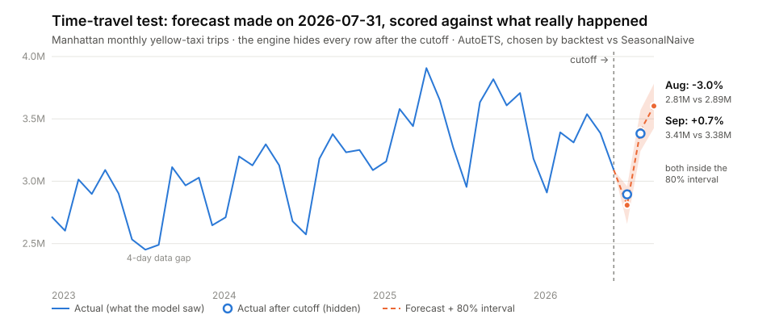
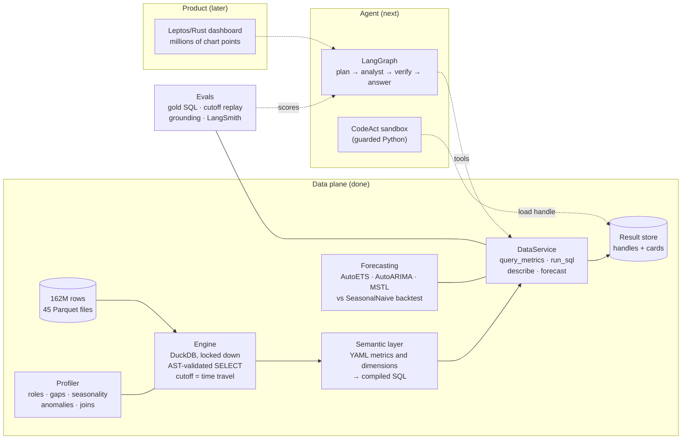
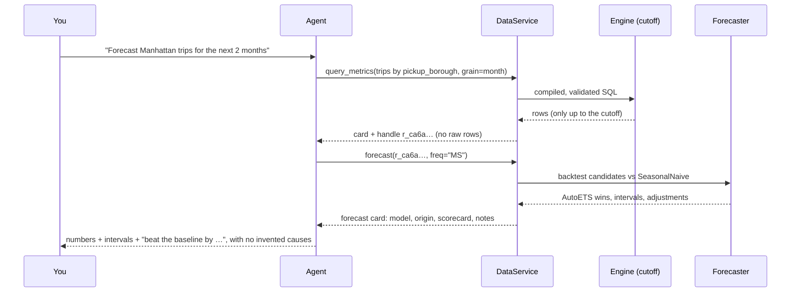

<div align="center">

# Big-Data Forecasting Agent

**An AI data analyst for 162 million taxi trips. It answers in numbers, forecasts with backtests, and doesn't make up reasons.**

<sub>DuckDB over Parquet · a governed semantic layer · StatsForecast with honest baselines · time-travel evaluation</sub>

<br/>


[](LICENSE)


</div>

---

<picture>
  <source media="(prefers-color-scheme: dark)" srcset="docs/assets/hero-forecast-dark.svg">
  
</picture>

> **The time-travel test.** The engine is told the data ends on **2026-07-31**. Every row after that date is hidden inside the database engine itself, not by a convention in a prompt. The forecaster then predicts the following months, and the hidden truth scores it. **August: off by 3.0%. September: off by 0.7%. Both inside the 80% interval.**

## Why this exists

Most "chat with your data" demos give an LLM raw rows and hope for the best. This project is built the other way around:

| | Typical text-to-SQL demo | This agent |
|---|---|---|
| **What the LLM sees** | raw result rows | a **summary card** of 4 KB or less, plus a handle; raw rows never enter the context |
| **Metric definitions** | invented per question | a **governed semantic layer** (YAML), the same definitions every time |
| **SQL safety** | "please only SELECT" | the query tree is **parsed and checked**: only dataset views, plain identifiers, no file reads |
| **Forecasts** | one model, one number | a **backtest against SeasonalNaive** on every call; if nothing beats the baseline, it says so |
| **Evaluation** | vibes | **cutoff replay** against real held-out months, plus a frozen **gold SQL** set |
| **New datasets** | rewrite prompts | a **deterministic profiler** drafts the dataset's memory; no taxi-specific code in `src/` (a test enforces it) |

## Architecture



<details>
<summary><b>How one question will flow through the system</b> once the agent lands (click to expand)</summary>



</details>

## Measured, not claimed

### 1. Cutoff replay picks the model lineup

Each model forecasts from three past cutoffs (2025-07-31, 2026-01-31 and 2026-07-31) and is scored against the real months that followed. A model stays in the default lineup only if it beats SeasonalNaive at 2 or more of the 3 cutoffs.

| Series | AutoETS | AutoARIMA | MSTL | HistoricAverage | Lineup |
|---|:---:|:---:|:---:|:---:|---|
| Daily trips (28-day horizon) | **3 / 3** | 2 / 3 | **3 / 3** | 2 / 3 | all five |
| Monthly trips by borough | 2 / 3 | 2 / 3 | n/a | 1 / 3 | AutoETS, AutoARIMA, SeasonalNaive |

<details>
<summary><b>Monthly relative MAE per cutoff</b> (below 1 beats SeasonalNaive)</summary>

| Model | 2025-07-31 | 2026-01-31 | 2026-07-31 |
|---|---:|---:|---:|
| AutoETS | **0.191** | 1.331 | **0.204** |
| AutoARIMA | **0.346** | 1.945 | **0.214** |
| HistoricAverage | 1.171 | 1.600 | **0.755** |
| SeasonalNaive | 1.000 | **1.000** | 1.000 |

At the January 2026 cutoff the baseline won. The report keeps that result rather than hiding it. With 3 origins and 3 boroughs these results are *indicative, not conclusive*, and the reports say so. Full tables: [`docs/results/`](docs/results/).

</details>

### 2. Governed answers match independent SQL

There are 15 gold questions in three tiers, written by hand as SQL directly against the views, with frozen answers in [`evals/gold/`](evals/gold/). For the tier-1 and tier-2 questions, the semantic layer must return the **same result set**:

```text
q001 trips in January 2024 ✅    q006 monthly trips by borough 2024  ✅
q002 trips on July 4, 2024 ✅    q007 Manhattan YoY, March 2026      ✅
q003 average fare 2024     ✅    q008 weekday vs weekend hour profile ⏳ no day-type dimension yet
q004 top-5 pickup zones    ✅    q009 tip rate by payment type       ✅
q005 payment-type split    ✅    q010 airport-pickup share           ⏳ no airport dimension yet
```

**8 / 10 match.** The other 2 are *strict* expected failures. They name the dimension that's missing, and they'll go red the moment it exists, so they can't silently rot.

### 3. Profiling 162M rows takes 19 seconds

A deterministic profile that uses no LLM. It works out each column's role, coverage, the **2023-09-21..24 data gap**, implausible timestamps, weekly and yearly seasonality, anomalies, and lookup dependencies (such as zone → borough). All of it is pushed down into DuckDB aggregates.

<details>
<summary><b>See a real tool response</b>: the summary card the agent receives</summary>

```text
handle: r_295caf537f
rows: 24
columns: unique_id:large_string, ds:timestamp[s], yhat:double, lo_80:double, hi_80:double, lo_95:double, hi_95:double
produced_by: forecast
governed: True
elapsed_s: 13.44
notes: [Manhattan] scaled 2023-09 for 4 known-gap days (2023-09-21..2023-09-24), …
       backtest windows reduced from 12 to 6 (insufficient history)
meta: {"model": "AutoETS", "beats_baseline": true, "origin": "2026-07-01T00:00:00", "horizon": 3,
       "backtest_handle": "r_22730fa229",
       "backtest_summary": {"best_model": "AutoETS", "mean_relative_mae": 0.8573, "mean_mase": 0.6998,
                            "mean_coverage_80": 0.6875, "mean_coverage_95": 0.8125, "baseline_mean_mase": 0.8015}}
stats:
  yhat nulls=0 min=322.90 max=3603317.44 mean=465882.59
preview:
| unique_id | ds         | yhat       | lo_80      | hi_80      | …
```

Every adjustment is written down: imputed gaps, scaled months, shortened backtests and skipped models. An honest number with its caveats beats a confident one without them.

</details>

<details>
<summary><b>The engine is a security boundary</b>: what it blocks</summary>

The agent can only `SELECT` from the dataset's views. Before execution, each query is serialized to its parse tree (`json_serialize_sql`) and checked:

- **Rejected:** `read_parquet(...)`, file paths used as tables, `glob`, `query()`, `duckdb_*` / `information_schema` / `pg_catalog`, and any table function except `range`, `generate_series` and `unnest`.
- **Allowed table names:** only dataset views or CTEs scoped to the query, written as plain identifiers.
- **Locked down:** DuckDB runs with `enable_external_access=false`, `allowed_directories`, `lock_configuration` and a memory limit.
- **Result handles** must match the minted id shape, so `../` and absolute paths are refused.

A whole-branch review ran about 40 bypass probes against these guards. Every one was blocked.

</details>

## Quick start

```bash
git clone https://github.com/mostafa7arafa/big-data-forecasting-agent && cd big-data-forecasting-agent
uv sync                          # Python 3.12, everything pinned in uv.lock
make test                        # 260+ unit tests on synthetic data, ~25 s

scripts/download_data.sh         # 45 monthly NYC TLC files (2023-01..2026-09), ~2.6 GB, resumable
make test-taxi                   # integration tests on the real 162M rows
make replay                      # rerun the cutoff replay → docs/results/
```

```python
import datetime as dt
from analyst.data.dataset import load_dataset
from analyst.data.service import DataService
from analyst.semantic.compiler import MetricQuery

svc = DataService(load_dataset("nyc_taxi"), cutoff=dt.datetime(2026, 7, 31, 23, 59, 59))

card = svc.query_metrics(MetricQuery(metrics=["trips"], dimensions=["pickup_borough"], grain="month"))
fc = svc.forecast(card.handle_id, value_col="trips", id_col="pickup_borough", freq="MS")
print(fc.render())               # model, origin, backtest vs SeasonalNaive, intervals, notes
```

## Project layout

```text
src/analyst/
├── data/          engine (security boundary), result store, DataService facade
├── semantic/      YAML model, metric → SQL compiler, value resolution
├── forecasting/   series prep, backtest + selection, cutoff replay
├── calibration/   deterministic dataset profiler
└── memory/        per-dataset memory files
datasets/nyc_taxi/ every taxi-specific fact lives here, never in src/
evals/             result-set grader, gold SQL set, frozen answers
docs/              spec, plans, research, results
```

## Roadmap

- [x] **Plan A: data and forecasting core.** Engine, semantic layer, forecasting, cutoff replay, profiler, gold set ([PR #1](https://github.com/mostafa7arafa/big-data-forecasting-agent/pull/1))
- [ ] **Plan B: the agent.** LangGraph analyst with `create_agent`, a guarded CodeAct sandbox, OpenAI / OpenRouter / NanoGPT providers, context compaction, LangSmith tracing
- [ ] **Plan C: calibration and memory.** The agent drafts a new dataset's semantic layer from the profile, you approve it, and it remembers per user across sessions
- [ ] **Plan D: evals at scale.** About 70 gold questions, agent-level cutoff replay, grounding checks, model comparisons, a second non-taxi dataset
- [ ] **Web: Leptos/Rust dashboard.** Built to render millions of chart points without lag

## How it's built

Spec first, then a plan, then implementation by agents with independent review. Each task was built by a delegated coding agent (Cursor, or Pi running a Codex model). A separate model reviewed each task for spec compliance and code quality, and an opus-level review and CodeRabbit covered the whole branch before merge. Every judgment call is recorded with its cost if wrong in [`docs/superpowers/plans/2026-11-08-plan-a-followups.md`](docs/superpowers/plans/2026-11-08-plan-a-followups.md).

<div align="center">
<sub>Data: <a href="https://www.nyc.gov/site/tlc/about/tlc-trip-record-data.page">NYC TLC Trip Record Data</a> · built by <a href="https://github.com/mostafa7arafa">Mostafa Arafa</a> · <a href="LICENSE">MIT License</a></sub>
</div>
